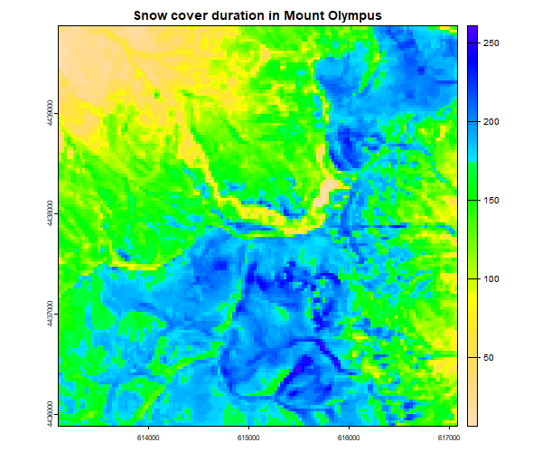

# snowman

**snowman** is an open-source R package that maps snow cover at fine spatial resolution from open optical satellite imagery. For any area you choose, it downloads the imagery, classifies every pixel into land, water, snow (or ice), cloud and artefacts, and turns the classified time series into multi-year snow phenology maps.

- **Landsat** (30 m, 1982–present): Landsat 4–5 TM, 7 ETM+ and 8–9 OLI, with a separate classifier for each sensor.
- **Sentinel-2** (10 m, 2017–present): Sentinel-2A, 2B and 2C, with one classifier for all three.

The outputs are **multi-year averages** over the period you select: snow cover duration, melt-out day, snow onset day and related metrics, with per-pixel uncertainty and data-coverage layers. snowman does not produce year-by-year estimates.

Everything runs locally, on a laptop or an HPC system. The imagery is read from the [Microsoft Planetary Computer](https://planetarycomputer.microsoft.com/) through the open STAC API, without sign-ins, and only the part of each image that covers your area is downloaded.

## How it works

| Step | Landsat | Sentinel-2 | What it does |
| --- | --- | --- | --- |
| 1. Download | `extract_landsat()` | `extract_sentinel2()` | Finds and downloads the images of your area and period, checks them, and drops nearly empty or fully cloudy ones |
| 2. Predictors | `calc_predictors()` | `calc_predictors_s2()` | Elevation, slope, ESA WorldCover water fraction, monthly median images and median spectral indices for your area |
| 3. Classify | `classify_landsat()` | `classify_sentinel2()` | Classifies every pixel of every image with the pretrained gradient-boosted classifiers, and writes the class and class probabilities |
| 4. Snow metrics | `calc_snow_variables()` | `calc_snow_variables()` | Fits a seasonal snow curve to each pixel's observations from all years and derives the snow phenology metrics |

The classifier models are included in the package. Nothing needs to be downloaded separately.

## Installation

```r
# install.packages("pak")
pak::pak("poniitty/snowman")
```

Keep R and the dependent packages (especially `terra`, `sf`, `future` and `lightgbm`) up to date. Older versions have caused problems with parallel processing.

## Tutorial: snow cover on Mount Olympus with Landsat

This example maps snow cover on Mount Olympus, Greece, averaged over 2020–2024.

### Set up

```r
library(terra)
library(snowman)

n_workers <- 4                         # parallel workers; more for download, fewer if memory is short

base_landsat_path <- "C:/MyTemp/RS/"   # a folder for the Landsat data (use its own folder per sensor)

site <- "Olympos"                                # a name for the area
aoi_point <- list(lon = 22.349975, lat = 40.083285)   # centre point of the area
buffer_size <- 2                                 # half-width of the square area (km)
# Instead of a point you can give a polygon (sf object), e.g. a 20 x 20 km tile.

starting_date <- "2020-01-01"
ending_date   <- "2024-12-31"
```

### 1. Download Landsat imagery

```r
image_df <- extract_landsat(aoi = aoi_point,
                            site_name = site,
                            aoi_size = buffer_size,
                            start_date = starting_date,
                            end_date = ending_date,
                            months = 1:12,
                            sats = c("LT04", "LT05", "LE07", "LC08", "LC09"),
                            minclouds = 50,          # skip scenes with more than 50% catalogue cloud cover
                            base_landsat_dir = base_landsat_path,
                            workers = n_workers)
```

The function can be re-run at any time, for example with a later `end_date`: it only downloads scenes that are not yet known. If you come back in a new R session, `search_image_df()` reads the table of downloaded scenes again:

```r
image_df <- search_image_df(site_name = site, base_landsat_dir = base_landsat_path)
```

### 2. Calculate the predictors

```r
calc_predictors(image_df, site_name = site, base_landsat_dir = base_landsat_path)
```

### 3. Classify the imagery

```r
lss <- classify_landsat(image_df,
                        site_name = site,
                        base_landsat_dir = base_landsat_path,
                        workers = n_workers)
```

Each classified image has six layers: `class` (1 land, 2 water, 3 snow or ice, 4 cloud, 5 artefact) and the class probabilities in percent (`land`, `water`, `snow`, `cloud`, `artif`). Only the predictors the model uses are calculated. To use your own models instead of the bundled ones, give their folder in `model_dir`.

### 4. Calculate the snow metrics

```r
snow_vars <- calc_snow_variables(image_df,
                                 site_name = site,
                                 base_landsat_dir = base_landsat_path,
                                 workers = n_workers)
```

At least 50 images with less than 80% cloud are needed (both adjustable, see below).

### 5. Look at and save the results

```r
plot(snow_vars$scd, col = rev(topo.colors(100)), main = "Snow cover duration, Mount Olympus 2020-2024")

writeRaster(snow_vars, file.path(base_landsat_path, site, "snow_variables.tif"), datatype = "FLT4S")
```



## The snow metrics

For each pixel, snowman fits a binomial generalised additive model (a cyclic spline over the day of year) to the snow and no-snow observations from all images of the period. Each observation is weighted by its classification probability. The fitted curve gives, for every day of the year, how often the pixel is snow-covered on that day across the years.

| Layer | Meaning |
| --- | --- |
| `scd` | Snow cover duration (days): the sum of the daily snow probabilities, i.e. the expected number of snow-covered days per year. **The recommended duration metric.** |
| `snow_days` | Days with snow probability ≥ 0.5 |
| `melt` | Melt-out day of year: the curve drops below 0.5, i.e. the day after which the pixel is more often snow-free than snow-covered (about the median melt-out date of the period) |
| `ns` | Snow onset day of year: the curve rises above 0.5 |
| `max_snow_doy`, `min_snow_doy`, `max_snow_prop`, `min_snow_prop` | Timing and level of the highest and lowest snow probability (30-day moving mean) |
| `scd_raw` | Weighted share of snow observations × 365 (a diagnostic, without the model) |
| `nobs`, `nyears` | Number of observation days and years |
| `gamr2` | Deviance explained by the fitted curve |
| `scd_se`, `melt_se`, `ns_se` | Standard errors (days) of snow cover duration, melt-out and onset |
| `melt_nobs`, `ns_nobs` | Observations within ±30 days of melt-out and onset |
| `esalc`, `elevation`, `ndvi` | ESA WorldCover class, elevation and median NDVI, for further analysis |

`melt` and `ns` are left empty where the curve never crosses 0.5 (snow all year or never). The standard errors are conservative and are best read as a relative measure of reliability. Together with `melt_nobs` and `ns_nobs`, they show where the critical times of the year are poorly covered by observations.

All thresholds are arguments of `calc_snow_variables()`:

| Argument | Default | Meaning |
| --- | --- | --- |
| `min_images` | 50 | Minimum number of images |
| `max_cloud` | 0.8 | Images classified as cloud in this share of the area or more are left out |
| `min_prob` | 20 | Class probabilities (%) below this are not used as observations |
| `min_obs` | 20 | Minimum observation days over the whole period for a pixel |
| `threshold` | 0.5 | Snow probability defining `snow_days`, `melt` and `ns` |
| `missing_months` | `"low_sun"` | Months without images get snow pseudo-observations only when the noon sun is below 15° (polar night, low winter sun) |

The settings used are stored with the result: `terra::metags(snow_vars)`.

## Sentinel-2

The same workflow runs on Sentinel-2 imagery at **10 m resolution** from 2017 onwards. Sentinel-2 revisits more often than Landsat, so the critical melt and onset periods are usually better covered by observations, but the record is much shorter.

```r
base_s2_path <- "C:/MyTemp/S2/"   # a separate folder from the Landsat data

image_df_s2 <- extract_sentinel2(aoi = aoi_point,
                                 site_name = site,
                                 aoi_size = buffer_size,
                                 start_date = "2019-01-01",
                                 end_date = "2024-12-31",
                                 base_sentinel2_dir = base_s2_path,
                                 workers = n_workers)

calc_predictors_s2(image_df_s2, site_name = site, base_sentinel2_dir = base_s2_path, workers = n_workers)

classify_sentinel2(image_df_s2, site_name = site, base_sentinel2_dir = base_s2_path, workers = n_workers)

snow_vars_s2 <- calc_snow_variables(image_df_s2, site_name = site,
                                    base_landsat_dir = base_s2_path, workers = n_workers)
```

Notes for Sentinel-2:

- **Only the bands the classifier needs are downloaded** (`bands = "model"`, the default). With the current model that is 8 of 13 layers, about a third less data to download and 40% less disk space. Use `bands = "all"` to download every band.
- **The monthly median images are skipped** when the model does not use them (the current one doesn't). This saves most of the time of `calc_predictors_s2()`.
- **The output has the same layers as for Landsat**, so the rest of your analysis works the same way.
- **Expect larger files and longer runs.** At 10 m an area has nine times as many pixels as at 30 m, so plan for more disk space and run time. `classify_sentinel2()` lowers the number of workers to fit the available memory.

## Running large areas and on HPC systems

- **Large areas:** split them into tiles (e.g. 20 × 20 km with `sf::st_make_grid()`), run snowman tile by tile and mosaic the results.
- **One sensor per base directory:** Landsat and Sentinel-2 use the same folder layout and file names, so they must be in separate base directories. snowman stops with a message if they are mixed. `calc_snow_variables()` uses one sensor at a time (argument `sensor`).
- **Parallel processing:** downloads are network-bound and benefit from more workers than cores (e.g. twice the number of cores). Classification and snow metrics use one core per worker.
- **OpenMP thread pinning:** on clusters where it is enabled (e.g. `OMP_PROC_BIND`), snowman starts its workers without it, so they don't end up sharing one core.
- **Memory:** `terra` judges free memory from the whole node, not from your job's limit. The heavier functions therefore have a `memmax` argument, and `classify_sentinel2()` reads the job's memory limit to choose the number of workers.
- **Disk space:** the downloaded images can be deleted once classified. The classifications are all that `calc_snow_variables()` needs, besides the predictors.

## Limitations

- **Multi-year averages.** The metrics describe the selected period as a whole. Several years of imagery are usually needed, and periods with more images (or more sensors) weigh more. Check `nobs`, `nyears` and the coverage layers.
- **Early decades.** Landsat coverage before about 2000 is sparse in many regions, sometimes with years without imagery.
- **Dense evergreen forest.** Snow under dense conifer canopies is difficult to detect, and snow cover duration is often underestimated there.
- **Polar night.** Months without any image are assumed snow-covered when the sun is low. This can overestimate ice cover on large lakes, fjords and coasts that stay open in winter.
- **Spectral confounders.** Bright rock, glacial lakes, rivers and mixed land-water pixels can be misclassified. Inspect such areas.
- **Snow and ice are one class.** Lake and glacier ice are mapped as "snow or ice", without separate validation for ice.

## Citation

Niittynen, P. (2026). snowman: an open-source R package for automated 30-m snow and ice cover mapping using the Landsat archive. *EarthArXiv*. <https://doi.org/10.31223/X5FF32>

Run `citation("snowman")` in R for a BibTeX entry. Please also cite the package version you used (see `NEWS.md` and `packageVersion("snowman")`).

## Contributing and issues

Bug reports and suggestions are welcome as [GitHub issues](https://github.com/poniitty/snowman/issues).